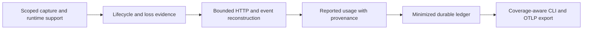

# TokenScope improvement research

Research date: 2026-10-08. Local source reviewed: `88b4ccf` on
`research/accounting-validation`. This is a research recommendation, not an
implementation plan approved for execution. Runtime code, the frozen study
protocol, historical evidence and baseline pins were not changed.

## Recommendation

Build a narrowly supported, trustworthy reported-usage monitor first. Its useful
distinction should be showing what was observed, which attempt it belongs to,
and where evidence is missing. Resolve privacy and capture/persistence problems
before adding dashboards, new TLS runtimes or billing claims.

The most promising research question is whether connection-level loss evidence
and conservative stream reconstruction can reduce confidently wrong accounting
without discarding too much recoverable usage. That is a hypothesis to test
against strong baselines, not an established novel method.

| Priority | Improvement | Evidence or reason | Decision gate |
| --- | --- | --- | --- |
| P0 | Make plaintext persistence an explicit choice | Full TLS chunks currently enter DuckDB; tail redaction does not protect that database | Synthetic secret sentinels absent from default database, WAL, logs and exports |
| P0 | Correct TLS write and lifecycle semantics | Entry probes capture attempted writes; TLS pointers and PIDs are insufficient lifetime identifiers | No duplicate requests from TLS retries, no cross-lifetime association |
| P0 | Make loss and persistence failure visible | Whole missing calls are not attributable; shutdown can leave queued events unwritten | Injected failures produce honest uncertainty and measurable loss |
| P1 | Implement HTTP/1.1 plus one provider usage parser | Raw capture is shipped; usage parsing is not | Exact identity and usage on complete synthetic controls; missing remains missing |
| P1 | Run independently qualified HTTP/2 diagnosis | Historical Go HTTP/2 main session failed its clean usage gate | Fresh-session controls qualify before condition comparisons |
| P2 | Add supported runtime adapters and OTLP export | Broader support carries maintenance costs; existing tools cover much of the basic functionality | Explicit per-runtime support tests and versioned export contract |
| P3 | Add task profiling, local-engine metrics and richer UI | Valuable only after the measurements underneath them are dependable | Demonstrated user value beyond existing tools |

## What the repository evidence supports

[DOC.md](../../DOC.md) records implementation through Phase 2.A: process and
network observation, DuckDB storage, control/query APIs and dynamically linked
OpenSSL capture. HTTP reconstruction and provider usage extraction are still
pending. The broad [SPEC.md](../../SPEC.md) is a vision, not evidence that those
features work.

The existing main summaries were read and their observer totals independently
summed during this review. These remain **historical synthetic measurements**,
not experiments rerun on this date:

| Historical observer path | Attempts | Identity matched | Emitted usage | Exact usage | Qualification |
| --- | ---: | ---: | ---: | ---: | --- |
| Python HTTP/1.1 | 4,100 | 4,100 | 2,460 | 2,460 | 10/10 initial clean checks exact |
| Go HTTP/1.1 | 4,100 | 1,612 | 2,460 | 1,113 | 10/10 initial clean checks exact |
| Go HTTP/2 main | 4,100 | 447 | 2,460 | 429 | 0/10 initial clean checks exact; diagnostic |

The earlier exclusive Go HTTP/2 screen had 27 exact usages out of 36 emitted
usages and four conflicting response identities, with two clean controls
passing. This finding and the unqualified main session must stay separate.
No reference errors were present in the inspected summaries. Matching a response
ID does not independently validate request metadata or logical task ownership.

See the [manuscript](accounting-manuscript.md) and
[execution notes](accounting-execution-notes.md). Ordinary seed cells share an
observer/client batch; their results do not supply independent-run confidence
intervals or an isolated causal effect of cancellation, retries or pressure.

Inspected summary SHA-256 values, retained for reevaluation:

| Local artifact | SHA-256 |
| --- | --- |
| `experiments/results/2026-09-29-python-main.json` | `b09345ffae8294ac882d54631eeff7bbde08c47141ce088496db9595dbc00691` |
| `experiments/results/2026-09-29-go-main.json` | `87ce07e4fdaf17da5206f26a1df56d334fab9681aab116950cec4ffb8efcf3fe` |
| `experiments/results/2026-09-29-go-obi-screen.json` | `b0c586a5ff655eca26d962b6490ad246125080e1899290d063e2f936fbcf1ba6` |

These hashes identify the summaries inspected; they do not constitute a fresh
verification of every original protobuf, log or archive.

## Concrete source findings to investigate before expansion

The findings below are source inspection results. Their operational frequency
and impact have not been measured in this review. Proposed tests are future work.

### F1: Default persistence conflicts with the privacy design

[sink.rs](../../crates/tsd/src/sink.rs) appends `e.plaintext.as_slice()` to
`events_tls_plaintext`. [control.rs](../../crates/tsd/src/control.rs) redacts only
the optional tail rendering. Full prompts, responses and credentials can
therefore enter storage independently of the subscriber's plaintext choice.
`Store::open` in [store.rs](../../crates/tsd/src/store.rs) creates the parent
directory without explicitly enforcing private directory/file modes. Actual
permissions depend on the surrounding environment; they were not audited here.
This differs from SPEC's default minimization and pre-persistence redaction.

Recommended design: ephemeral protocol processing followed by an allowlist of
accounting fields for persistence. Preserve bounded framing state in memory;
discard credential headers and content after extraction. Until such processing
exists, label any raw capture mode clearly and require explicit selection.
Debug capture should have scope, expiry, byte quota, private permissions and
retention rules. Regex redaction alone cannot guarantee prompt confidentiality.

Tail redaction is also applied independently to each chunk. A sensitive header
or token split across calls/chunks may evade those patterns. Validate every
split position using synthetic sentinels, including UTF-8 boundaries, compressed
bodies and HTTP/2 headers. Inspect database and WAL contents in those tests;
checking the visible tail alone is insufficient. Handle existing research
evidence separately rather than deleting it as part of a privacy migration.

### F2: Attempted TLS writes cannot define successful wire requests

`ssl_write_entry` and `ssl_write_ex_entry` in
[tls.bpf.c](../../bpf/tls.bpf.c) emit bytes before the result is known; the `_ex`
probe ignores the `written` output parameter. OpenSSL allows partial-write mode
and requires repeated arguments for retryable writes. A library retry can
therefore expose the same application bytes more than once.
[OpenSSL write semantics](https://docs.openssl.org/3.0/man3/SSL_write/)

Recommended investigation: retain entry/return evidence, accepted byte counts,
API variant and lifecycle identity. Commit bytes to the parser only under a
validated write-state rule. Preserve separate attempted-write diagnostics.
Successful SSL acceptance is still weaker than proof that a remote server
received a request. Do not deduplicate by payload hash: two independent requests
can have identical bodies.

Use nonblocking synthetic TLS fixtures that force retry, partial success and
fatal failure. Compare accepted application bytes with server receipt inventory.
Test whether the selected OpenSSL build introduces nested probe invocations.
Do not assume generic return probes are portable to Go's runtime.

### F3: The read collision counter does not measure its documented event

Both read entry probes use `bpf_map_update_elem(..., BPF_ANY)` and increment
`tls_inflight_collision` only when the update returns an error. Successful
replacement of an existing slot is not detected by that branch. The comment
describes overwrite collisions, so a zero counter is not evidence of no
overwrites. Read exit probes also return on unsuccessful calls before deleting
their inflight slot. Those slots can persist until replacement or eviction.

Investigate distinct counters for existing-slot replacement, map update failure,
missing return state and out-parameter read failure. Remove the correct inflight
entry on every completed invocation, including failures, with explicit rules
for nested calls and variant mismatch. A fixture should force failed reads,
same-thread repeated calls and nested entries, then compare counter changes and
map state against its known call inventory.

### F4: Connection and process lifetimes need explicit identity

[ts_event.h](../../bpf/ts_event.h) identifies chunks using TGID, `SSL*`, direction
and call timestamp. It orders chunks within a call, but does not carry a process
generation, SSL-object generation or a per-direction call sequence. A timestamp
does not describe a missing call or establish that a reused pointer names the
same connection. No SSL creation/free lifecycle probes appear in the inspected
TLS probe file.

Recommended identity: host boot/capture epoch, process lifetime, connection
generation, direction and monotonic sequence; then HTTP/2 stream ID or HTTP/1.1
request ordinal. Investigate SSL lifecycle probes and BIO/socket association,
including non-socket BIOs and attach-after-creation. Missing lifecycle evidence
must yield an uncertain association. Test pointer/PID reuse, reconnects, pooled
connections, fork/exec, discovery delay and attachment after traffic starts.

### F5: Aggregate loss counters cannot establish per-attempt completeness

The probe stops on the first ring-buffer reservation failure. Userspace counts
a full sink channel, and chunk metadata can expose missing pieces of a call
that was partly observed. If every record from a call disappears, there is no
call record with which to associate the gap. The kernel ring-buffer API permits
nonblocking reservation failure and preserves reservation ordering; it does
not supply HTTP stream attribution.
[Kernel ring-buffer documentation](https://docs.kernel.org/bpf/ringbuf.html)

Investigate per-connection/direction sequences advanced before emission, sticky
loss epochs, independently readable call/byte inventories and parser state
invalidation. Metadata itself can be lost: the next record, checkpoint or
lifecycle closure must reconcile inventory, and an unclosed final interval
must remain unverified. A global loss delta with unknown scope should prevent
claims of completeness for potentially affected intervals, without fabricating
which specific request was lost.

Inject middle-chunk loss, whole-call loss, final-call loss, user-copy failure,
map exhaustion and userspace queue overflow independently. Measure false
completeness claims and the amount of valid usage unnecessarily discarded.
This is a proposed mechanism, not a demonstrated recovery feature.

### F6: Persistence needs a defined drain and failure contract

`EventSink::drop` sets the shutdown flag before joining its writer. The writer
loop stops on that flag without an explicit drain of remaining channel items.
Its final Appender flush covers rows already appended, not queued events. Under
continuous arrivals, the explicit periodic flush is reached only on a receive
timeout; that path alone cannot guarantee the documented roughly one-second
visibility interval. Appender/internal behavior may add other flushes, which
were not measured. Persistence failures warn while subscriber output can
continue, and the final explicit flush result is ignored.

Investigate a bounded producer-stop/drain/flush sequence, a flush deadline
checked during busy ingestion, writer health, persistence error counters and a
durable watermark. Tail observation and successful persistence should be
separate facts. Future tests should enqueue a known inventory before shutdown,
keep a producer continuously busy, and inject append/flush failures. Preserve
DuckDB ownership inside one writer process; benchmark before changing engines.
[DuckDB concurrency model](https://duckdb.org/docs/current/connect/concurrency)

### F7: Short hashes and metadata need narrower meanings

`sha256_prefix_8` in control.rs returns four digest bytes: a 32-bit fingerprint.
Using the birthday approximation, roughly 77,163 distinct uniformly distributed
values give about a 50% collision probability. This is a mathematical estimate,
not an observed collision rate. The prefix should not establish identity or
exact deduplication. Use event/lifecycle IDs for that purpose; consider omitting
content fingerprints by default or using longer scoped keyed fingerprints when
an explicit use case justifies them.

Tail TLS records also omit the stored `read_failed` flag. Future status/export
contracts should retain capture-failure reasons. Audit process command lines as
another sensitive input, not only TLS content. Document actual support instead
of interpreting an empty capture as zero usage. README's Rust 1.83 prerequisite
also differs from the pinned 1.86.0 toolchain; resolve that documentation drift
when preparing implementation instructions.

## Protocol and usage semantics worth getting right

For an initial deliverable, choose Python with dynamically linked OpenSSL,
HTTP/1.1, and one provider-shaped endpoint. Use a replayable parser independent
of privileged capture. Build HTTP framing, optional decompression, SSE/NDJSON
framing and provider extraction as separate bounded stages.

HTTP/1.1 needs body-length precedence, chunked decoding, informational/bodyless
responses and keep-alive request/response association. Treat invalid or
ambiguous framing as uncertainty. SSE requires incremental UTF-8 handling,
line endings, multiline data, comments and blank-line dispatch. TLS call
boundaries are not event boundaries.
[RFC 9112](https://www.rfc-editor.org/rfc/rfc9112.html),
[WHATWG SSE parsing](https://html.spec.whatwg.org/multipage/server-sent-events.html)

HTTP/2 requires incremental frame parsing and stream state across arbitrary
fragments, including HEADERS/CONTINUATION, DATA, resets and shutdown. HPACK has
separate directional dynamic tables shared across a connection's streams. Late
attachment or missing header updates can leave decoding state unavailable.
Recognizing a plausible DATA frame or usage object does not restore missing
request identity. Preserve orphan observations, and resume trusted association
only after demonstrable state recovery or a fresh connection.
[RFC 9113](https://www.rfc-editor.org/rfc/rfc9113.html),
[RFC 7541](https://www.rfc-editor.org/rfc/rfc7541.html)

Provider tests should explicitly cover these distinctions:

| Case | Required behavior | Primary evidence |
| --- | --- | --- |
| OpenAI Chat Completions usage-inclusive streaming | Parse the separate final usage chunk even with empty `choices`; interrupted streams can lack it | [Official API reference](https://developers.openai.com/api/reference/resources/chat/subresources/completions/methods/create) |
| Output text versus reported output counts | Keep local text-token estimates separate; invisible formatting and other generated tokens can make totals differ | [Official token-counting guide](https://developers.openai.com/api/docs/guides/token-counting) |
| Anthropic streaming deltas | Treat usage values as cumulative snapshots, not increments to sum; preserve partial/error state | [Streaming documentation](https://platform.claude.com/docs/en/build-with-claude/streaming) |
| Cache categories | Preserve cache read/write classes and provider-specific inclusion rules before normalizing or pricing | [Anthropic prompt caching](https://platform.claude.com/docs/en/build-with-claude/prompt-caching), [OTel attribute definitions](https://opentelemetry.io/docs/specs/semconv/registry/attributes/gen-ai/) |
| Missing, explicit zero, duplicate, conflicting | Separate all four; never fill absent counts with zero or sum repeated exports | Existing [scorer checks](../../experiments/test-accounting-score.py) |

Add Responses-style, Ollama NDJSON and other providers only with separate golden
fixtures and terminal-event semantics. Do not infer reasoning/cache totals from
visible content. Keep request model and reported serving model separately when
they differ.

## A useful accounting contract

The proposed pipeline is:

Keep independent fields for runtime support, request association, capture
integrity, response termination, usage availability and persistence. A complete
response can omit usage; an interrupted response can expose some reported
counts; an exact count field alone does not prove a complete request/task total.

Suggested usage states are `reported`, `reported_partial`, `absent`,
`conflicting`, and `estimated`. Each reported field needs its observed event
provenance; estimates need a method/version. Record why evidence is unavailable:
unsupported runtime, not yet attached, missing lifecycle, byte gap, parser
failure, cap, cancellation or missing provider field. Query summaries should
show observed totals alongside matched attempts, unknown attempts, unsupported
workloads and conflicting records. Even the number of attempts can be unknown
when capture starts late or an entire connection is invisible.

An optional application/OTLP source can establish task identity where available.
Keep that source explicit and evaluate it separately from passive reconstruction.
Body hashes, process ancestry and nearby timestamps can suggest relationships;
they cannot establish an application's retry/task ownership unconditionally.
Deduplicate cross-source observations using verified identity, preserving
conflicts rather than selecting the larger count.

Price only well-defined token categories against a dated price snapshot,
provider/model mapping, currency and service tier. Use decimal or integer money
units. Missing categories, unknown models, separate tool charges and unavailable
contract rates make a full bill unavailable. Display a clearly labeled list-rate
estimate or observed subtotal, never an authoritative invoice. The existing
synthetic study is not billing validation.

OTel's old GenAI documentation now reports a move to a dedicated repository.
Pin the convention revision used for exports, provide a mapping from the richer
internal ledger, and version it independently of provider parsers. This review
confirmed the move, not every attribute in the new repository.
[OTel relocation notice](https://opentelemetry.io/docs/specs/semconv/gen-ai/gen-ai-spans/),
[GenAI conventions repository](https://github.com/open-telemetry/semantic-conventions-genai)

## What current prior work changes about the improvement strategy

These sources were inspected on the research date. Moving repository pages are
feature/source references, not pinned experiments or independently reproduced
performance. The original study's OBI v0.13.0 and agtap v0.1.0 pins remain intact.

| Primary source | Relevant scope inspected | Implication for TokenScope |
| --- | --- | --- |
| [OBI feature documentation](https://github.com/open-telemetry/opentelemetry-ebpf-instrumentation/blob/main/devdocs/features.md) | Existing GenAI parsing; missing usage omitted and zero preserved; HTTP/2 body capture restricted to Go clients | Basic token extraction/unknown handling is established. Generic HTTP/2 traces do not establish body coverage |
| [agtap repository](https://github.com/zhebrak/agtap) | HTTP/1.1 reconstruction; documented Go/rustls and HTTP/2/3 gaps | Benchmark supported configurations; unsupported protocol results are not new defects |
| [AgentSight repository](https://github.com/eunomia-bpf/agentsight) | Current capture/library surface, local-session profiling and OTLP export | Local observability plus a UI is already a substantial existing direction; evaluate reuse before duplicating it |
| [eBeeMetrics paper, v1](https://arxiv.org/html/2603.25067v1) | Request boundary/identity analysis for HTTP/1.1 and gRPC/HTTP/2 | Stream identification alone is not a new research contribution |
| [OTel Go instrumentation design](https://github.com/open-telemetry/opentelemetry-go-instrumentation/blob/main/docs/how-it-works.md) | Version-dependent offsets, stripped binaries, Go return-site instrumentation | Go capture requires ABI/version engineering beyond locating function names |
| [AgentPProf, v1, September 14](https://arxiv.org/abs/2609.20301v1) | Abstract: semantic operation segmentation and hierarchical resource profiling | Task/cost profiling has recent adjacent work; any such direction needs a separate comparison |
| [Agent-Warden, v1, September 29](https://arxiv.org/abs/2609.38245v1) | Abstract: process/file provenance and lifetime-coupled state | Kernel provenance is an existing research direction, distinct from usage extraction |
| [AI Observability for Developer Productivity Tools, v1](https://arxiv.org/abs/2604.17092v1) | Abstract: reported usage, pricing registries and workflow cost analytics | A pricing dashboard alone does not establish novelty; its billing claims were not reproduced here |

The three abstract-level inspections are discovery leads, not full methodological
reviews. Do not transfer their accuracy or overhead results to this project.
The earlier [literature review](2026-09-29-accounting-validation.md) remains useful,
but its descriptions of moving projects require reevaluation before publication.

A candidate contribution would combine a specified completeness contract,
observable loss evidence and a controlled accuracy/coverage tradeoff. Compare
against OBI, a supported HTTP/1.1 alternative, an ideal replay decoder and an
explicit application ledger. Remove each proposed mechanism in an ablation.
If a current baseline already provides equivalent behavior, contribute the
fixtures or an upstream fix instead of presenting it as a new method.

## Follow-up experiments in dependency order

All experiments below are **proposed, not run**. Version the next protocol before
execution and keep historical data unchanged. Retain failed qualification runs;
report their frequency rather than quietly selecting favorable sessions.

| Experiment | Controlled comparison | Measurement and gate |
| --- | --- | --- |
| E1: Fresh observer qualification | Restart observer/client for each repetition; stable attach/export readiness plus identifiable clean requests | Require exact counts and independent request/response association in clean controls before each scored batch; an initial ten fresh repetitions is a feasibility screen |
| E2: Explain Go HTTP/2 symptoms | Isolate read/frame alignment, frame density, pooling and prior scenario history; compare pinned historical baseline with a separately pinned current candidate | Observe actual boundaries, not only server write sizes. A root-cause claim needs a reproducer and an intervention that removes the symptom |
| E3: Capture and persistence contract | TLS retry/partial failure, inflight cleanup, lifetime reuse, shutdown drain, busy flush and write failures | Known inventories reconcile or become explicitly incomplete; no silently asserted durable completion |
| E4: Loss-aware reconstruction ablation | Complete capture versus middle/whole/final-call loss; with/without sequences, loss epochs and conservative invalidation | Exact coverage, misassociation, falsely complete totals, unknown rate, useful retained coverage and recovery delay |
| E5: Privacy and adversarial parsing | Split synthetic credentials at every boundary; ambiguous framing, oversized headers/events and bounded decompression | Default persistent/export surfaces contain no sentinels; limits produce explicit states rather than unbounded memory or guessed values |
| E6: Independent runtime/protocol matrix | OpenSSL/Python first; then Go, Node/static OpenSSL, rustls and an independent server/library/kernel | Capability labels require their own qualification; retain unsupported combinations separately |
| E7: Controlled overhead | Randomized paired control/observer blocks, identical workloads, fresh sessions and exclusive launcher lock | Report latency distribution, CPU, RSS, event/byte rates, queue/loss counters and storage volume at run level |
| E8: Provider/SDK realism | Local provider-shaped fixtures with recorded SDK versions, normal streaming options, caching classes and errors | Confirm classification and field semantics without special fixture-only hints; later authorized provider reconciliation remains separate |

Maintain distinct server receipt, server usage emission, client-consumed usage
and observer ledgers. A server's emitted usage does not prove the client received
it. Score both attempt association and field correctness; aggregate token totals
can hide swaps. Cancellation may remove terminal usage without any capture bug.

Use independent observer runs as the statistical unit, preregister the sample
size/analysis for any inferential claim, and report qualification failures.
Ten clean repetitions do not establish production reliability. Specify acceptable
false-assertion and coverage rates before measuring a proposed improvement;
requiring zero wrong claims in deterministic fixtures is a correctness gate,
not a probability bound for future workloads.

No GPU/model inference is needed for E1–E7. Privileged observers and longer
studies require an isolated synthetic workload, exclusive execution and recorded
environment/provenance. An agtap comparison remains unperformed; preserve its
isolated-kernel requirement from the reproduction guide.

## Research procedure, verification and pending work

Local review covered the README/design, TLS/event schema, capture handler,
writer/store, tail rendering, study protocol/execution notes/manuscript,
scorer/collector tests, baseline pins and the three summary files identified
above. It did not audit every daemon subsystem or read credentials, live traffic
databases or personal agent sessions.

Web searches used generic terms for eBPF LLM accounting, HTTP/2 attribution,
capture loss, current observability tools and provider usage semantics. Evidence
was limited to primary project documentation/source, standards, official provider
documentation and original papers. The OpenAI Docs skill was used for official
OpenAI usage semantics. This is a targeted review, not an exhaustive systematic
survey. Several direct raw-source/new-convention page fetches failed; detailed
claims about those unavailable pages were not inferred. No baseline binaries,
packages or model data were downloaded or installed.

Checks completed during this review:

| Check | Result |
| --- | --- |
| `.venv/bin/python experiments/test-accounting-score.py` | Exit 0; 6 tests passed |
| `.venv/bin/python experiments/test-accounting-collector.py` | Initial sandbox run exit 1: loopback socket denied. Rerun with loopback permission exit 0; 1 test passed |
| Historical summary aggregation | Exit 0; manuscript totals/qualification above reproduced from summary fields; zero listed reference errors |
| Documentation local links and UTF-8/LF validation | Exit 0; 18 local links resolved; UTF-8, LF, terminal newlines and absence of workstation paths checked |
| Historical summary preservation | Exit 0; all three inspected summary hashes unchanged |
| `git diff --check` | Exit 0; no whitespace errors |

The collector test used temporary synthetic OTLP data and an ephemeral loopback
port; it made no provider requests. No full Rust build/test, privileged capture,
fresh accounting matrix, overhead measurement, privacy sentinel test or billing
reconciliation was run. The source findings remain pending implementation and
focused reproduction. No Claude/human review, deployment, publication, push or
new research-method validation is claimed.

Reevaluate this recommendation after E1/E2, before widening support, and before
making a paper claim. My preferred first implementation scope is F1–F6 plus a
bounded HTTP/1.1/one-provider replay path, with its own reviewed plan and gates.
