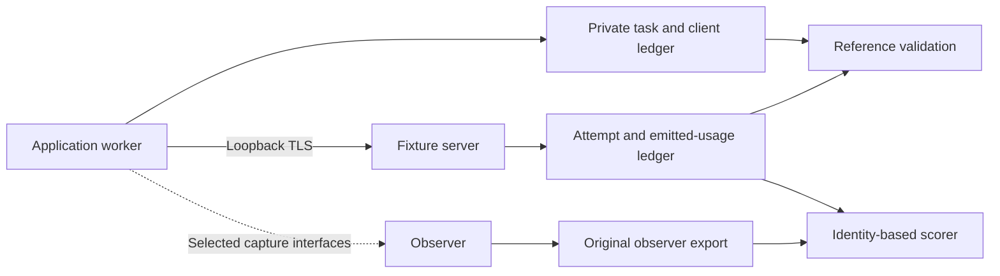

# When Passive LLM Usage Accounting Has Enough Evidence

**Hoang Le**

Working manuscript, 2026-09-29. Affiliation not specified. Venue undecided.
**Technical-report draft: measurements complete; author review and venue pending.**

## Abstract

Host-side observability can recover token counts reported in LLM responses, but
reported usage, network attempts, application tasks and provider billing are
different targets. We define an evidence model that separates these quantities
and a local TLS benchmark with independent server and application ledgers.
Observation-equivalent executions show why unseen remote totals and untransmitted
task grouping cannot always be recovered exactly. Our main study of pinned
OpenTelemetry eBPF Instrumentation includes 1,620 control/observer trial cells
and 24,600 scored synthetic attempts, with no reference-ledger mismatches.
Python HTTP/1.1 matches all 4,100 observed attempts and recovers all 2,460 emitted
usages exactly, leaving 1,640 usages unknown. Go HTTP/1.1 matches 1,612 of 4,100
attempts and recovers 1,113 of 2,460 emitted usages exactly; matched records
contain no incorrect counts. An earlier qualified Go HTTP/2 screen contains
four response identities with conflicting count exports. Its separate main
session fails clean usage qualification and remains diagnostic. Python HTTP/2
payload capture is documented as unsupported. These findings describe one
kernel, fixture and workload sequence. We present a scoped accounting benchmark
and technical report, without claiming a new parsing mechanism, exact provider
billing, production reliability or established research novelty.

## 1. Motivation and research target

An operator wants to know which request consumed tokens and whether their total
is complete. Summing visible usage fields can produce a plausible total even
when counts belong to the wrong attempts. Conversely, a missing field may
correctly express insufficient evidence. A benchmark must evaluate identity,
coverage and correctness separately.

The broad idea of observing LLM agents through eBPF is established.
[AgentSight](https://arxiv.org/abs/2508.02736) combines TLS traffic with system
events to analyze agent behavior. [eInfer](https://jianchang.su/uploads/eInfer.pdf)
addresses distributed inference tracing, and
[ProfInfer](https://arxiv.org/abs/2601.20755) profiles local inference engines.
Our candidate target is the accounting evidence retained per network attempt
under streaming and failure conditions. A targeted literature review did not
locate this complete comparison; that is not an exhaustive novelty claim.

The central empirical question is: **under which supported conditions do passive
observers recover the correct reported usage for the correct network attempt,
and what do they expose when evidence is insufficient?** We further ask how
capture limits, interruptions, retries and late attachment affect coverage, and
what overhead occurs in comparable supported configurations.

## 2. Observation model and information limits

Let an execution be `E`, its observer-visible evidence be `O(E)`, and the target
accounting quantity be `T(E)`. The observer can inspect specified local process,
transport and TLS events. It has no remote provider ledger and no application
task ledger or arbitrary application-memory instrumentation. TLS plaintext may
be partial. Initial HTTP/2 and HPACK state may also be unavailable.

We distinguish four quantities:

- **Network attempt:** one HTTP request, identified by connection lifetime and
  stream identity. An application retry creates another attempt.
- **Reported usage:** provider-shaped counts emitted in the response. These may
  be absent, explicitly zero, partial or complete.
- **Logical task:** application-defined grouping of attempts. The relation is
  available in our reference ledger but is not assumed observable on the wire.
- **Billed usage or cost:** authoritative remote accounting, which can include
  information outside the observed response. Our synthetic counts do not
  establish billing behavior for any real provider.

**Observation-equivalence proposition.** If `O(E1) = O(E2)` and
`T(E1) != T(E2)`, no deterministic function of the observation alone is correct
for both executions. It must output the same value on the same input, while the
correct targets differ. Randomization cannot guarantee correctness for both.
This is a basic information limit, not a claimed new theorem.

Two examples constrain the stronger accounting question. First, an interrupted
stream that exposes no final usage can be compatible with different unseen
remote totals. Without additional provider assumptions or evidence, the exact
total is not identified. Second, the same two observed request/response attempts
can be labeled as two independent tasks or as two attempts within one task in
an untransmitted application ledger. Identical request content is insufficient
to establish that grouping. These are constructed possible executions, not
measurements of a provider's cancellation or invoice policy.

These limits do not prevent recovering emitted usage from complete evidence.
[RFC 9113](https://www.rfc-editor.org/rfc/rfc9113.html) defines stream identities
and framing. Complete plaintext, adequate connection state and response usage
can make multiplexed attempts recoverable. Missing usage remains unknown;
explicitly reported zero remains a value.

## 3. Existing systems and candidate contribution

[OBI v0.13.0](https://github.com/open-telemetry/opentelemetry-ebpf-instrumentation/tree/v0.13.0)
supports GenAI extraction and preserves reported zero while omitting missing
usage. Its [pinned feature matrix](https://github.com/open-telemetry/opentelemetry-ebpf-instrumentation/blob/3cc19862cef1abdaaeaa2a6387b462d31822010e/devdocs/features.md)
distinguishes general HTTP/2 tracing from payload capture: HTTP/2 body capture
is available for Go clients, not generic Python/OpenSSL clients. The
[upstream implementation](https://github.com/open-telemetry/opentelemetry-ebpf-instrumentation/pull/2760)
uses payload heuristics when HTTP/2 headers are unavailable. A separate
[generic HTTP/2 multiplexing proposal](https://github.com/open-telemetry/opentelemetry-ebpf-instrumentation/pull/3296)
describes known frame-density and HPACK limitations and explicitly excludes
the Go path from its reported defect. It does not establish the cause of our
Go accounting observations.
[agtap v0.1.0](https://github.com/zhebrak/agtap/tree/v0.1.0) extracts streaming
LLM usage with optional counts and documents HTTP/1.1 reconstruction.
Neither tool should be called incorrect simply for lacking a documented
unsupported feature.

[eBeeMetrics](https://arxiv.org/abs/2603.25067) also establishes that multiplexed
RPC requests can be distinguished through suitable transport and stream
identifiers. Stream disambiguation and representing missing counts are therefore
not proposed as our contribution. The possible contribution is a reproducible
comparison of evidence and accounting behavior under controlled conditions,
provided measurements add useful findings beyond those documented limits.

TokenScope itself currently captures raw OpenSSL plaintext and does not yet
reconstruct usage. It is the project hosting this investigation, not a complete
accounting system evaluated against these baselines. A proposed recovery method
would require implementation and an ablation against the strongest baseline.

## 4. Experimental design

The [study protocol](accounting-study-protocol.md) fixes the initial matrix and
decision rules. Separate Python/OpenSSL and Go/net/http workers communicate
with a loopback TLS server using ALPN. The Go client uses the standard library
HTTP/2 implementation, independently of the Python hyper-h2 server. HTTP/1.1
uses concurrent connections; HTTP/2 interleaves
streams on one connection. Provider-shaped SSE responses contain assigned
synthetic counts, distinct opaque response identities and optional final usage.
No cloud API, tokenizer or model inference is used.

The server records receipt, usage emission and termination independently of the
application. Emission means handing complete usage bytes to the TLS writer and
draining that write; it does not itself prove remote delivery. The application
reference records received usage, actual cancellation/reset behavior and task
grouping. It invalidates a run if its attempt inventory, identities, statuses or
usage disagree with the server evidence. Task IDs are absent from traffic.

The scorer joins by response ID or explicitly captured opaque request identity.
It does not join by token values, request similarity or arrival order. It retains
unmatched records, recognizes duplicate exports and flags conflicting identity
or counts. Identical cumulative values are not summed repeatedly.

The main matrix uses concurrency 1, 8 and 32, both protocols and ten fixed seeds.
It includes complete delivery, missing usage, client cancellation, server
disconnection, 96 KiB content before final usage, HTTP 429 followed by a successful
retry, attachment after a completed exchange on a persistent connection, burst pressure and a
reported-zero control. Pressure is a workload condition; actual BPF loss must
be measured, not assumed. The initial screen uses four scenarios, two seeds and
concurrency 1 and 8. Late-attachment warm-up exchanges are retained separately
and excluded from scored attempt denominators.

OBI is configured for 128 KiB HTTP capture, local OTLP export and the fixture
PID. Clean HTTP/1.1 usage export must qualify the setup before comparisons.
The pinned agtap release additionally attaches system-wide JSON pipe probes,
with PID filtering after capture. It is reserved for a dedicated test kernel;
both observers must run there for comparable overhead. The host screen is OBI
only. The confirmatory host job uses Go for both protocols and Python for
HTTP/1.1. Startup failures are infrastructure outcomes and are never counted as
zero-coverage trials. Overlapping experiment executions are excluded from
confirmation; launchers now share an exclusive lock.

## 5. Metrics and analysis

Attempt recall is matched unique attempts divided by server-received attempts.
Exact-usage coverage is correctly identified and counted attempts divided by
attempts with emitted usage. We separately report missing attempts, unknown or
partial usage, incorrect counts, conflicting duplicates and unsupported cells.
Unknown usage is not itself a wrong count.

Aggregate totals include the known matched component counts and the emitted
reference totals, with missingness disclosed. Per-attempt absolute error on
known components prevents offsetting mistakes from disappearing in a total.
Completeness signals are evaluated only if a tool explicitly exposes them;
absence of such a signal is recorded as not exposed.

Two screening repetitions are shown as raw outcomes without an interval.
The implemented ordinary matrix batches seed cells in a shared client/observer
session; these are repeated conditions rather than independent observer runs.
We report means and ranges without independent-run confidence intervals.
Late-attachment cells restart both processes; their ten repetitions support
run-level bootstrap summaries under the fixed-workload limits. Their support
label inherits the corresponding ordinary batch's clean check; these intentionally
late observers have no separate pre-workload usage control. Raw rows are
retained. A zero observed error rate does not
establish universal correctness. Client duration and CPU are paired with the
unobserved control. Process RSS is a lifetime high-water mark; short CPU samples
have scheduler-tick resolution. Longer steady workloads are needed before making
performance claims, and VM and host overhead must not be pooled. The
[execution notes](accounting-execution-notes.md) record session-history,
exclusion and analysis limitations discovered during execution.

## 6. Measurements

The in-memory HTTP/2 control used a hyper-h2 receiver with complete initial
state. Across 45 configurations, all 615 complete synthetic attempts recovered
their assigned usage. Missing usage and interruption produced unknown counts;
omitting one usage DATA frame produced seven exact and one unknown result among
eight attempts. A deliberately modeled 64 KiB capture cap hid final usage.
Those are replay controls, not actual eBPF loss or TLS-call size measurements.

Each of the Python and Go TLS fixtures completed 108 trials and 1,640 scored
attempts with no server/application ledger mismatches. Each emitted usage for
984 attempts and withheld it for 656; twelve warm-up exchanges per runtime
were unscored. HTTP/2 cancellation sent real `RST_STREAM` frames, and
server interruption reset streams. The fixture also exercised real loopback
TLS, flow control and SSE bodies larger than 96 KiB.

| TLS fixture scenario | Network attempts | Emitted usage attempts | Reference mismatches |
| --- | ---: | ---: | ---: |
| Complete | 164 | 164 | 0 |
| No usage | 164 | 0 | 0 |
| Client cancellation | 164 | 0 | 0 |
| Server disconnect/reset | 164 | 0 | 0 |
| Large body | 164 | 164 | 0 |
| Retry, including first HTTP 429 | 328 | 164 | 0 |
| Pre-established connection | 164 | 164 | 0 |
| Burst pressure | 164 | 164 | 0 |
| Reported zero | 164 | 164 | 0 |

Each row describes one runtime, combining both protocols, three concurrencies
and two seeds. The retry
row includes two attempts per application task. The pre-established-connection
control validates the workload, not an observer's late-attachment recovery.
The counters and resource records are fixtures, not independent production
observations or confidence estimates for a tool.

Six adversarial scoring checks distinguish zero, missing usage and missing
attempts; reject swapped counts despite correct aggregate totals; preserve
unmatched/conflicting identities; and avoid double-counting duplicates.

The valid Python OBI screen completed 64 control/observer trial cells. For
HTTP/1.1, OBI matched all 90 server attempts, recovered all 36 emitted usages
exactly and retained unknown usage for the other 54 attempts. No conflicting
duplicates or incorrect counts were observed. Complete responses and successful
retry attempts supplied the 36 emitted usages; omitted usage, cancellation and
first HTTP 429 attempts supplied the unknown values. The two fixed seeds do not
support confidence intervals or general reliability claims.

For Python HTTP/2, the same fixture passed its reference checks, but none of
the 90 attempts had an identity-matched GenAI record. This concerns usage
records, not the absence of generic HTTP traces. The pinned baseline documents
this payload path as unsupported; it is not evidence of a new defect.
The [screen summary](../../experiments/results/2026-09-29-obi-screen.json)
retains denominators and evidence hashes. An earlier JSON-only collector rejected
OBI's protobuf exports; that run is invalid and contributes no accuracy results.

Both Go clean, concurrency-one usage checks passed, including the supported
HTTP/2 path. Two confirmation launchers were inadvertently active together.
Their screens showed missing records and conflicting identity/count exports,
but overlapping observers and workloads prevent treating these as confirmed
baseline failures or comparable overhead. Their raw evidence is retained for
diagnosis; both executions are excluded from confirmation. The prepared clean
rerun qualified both protocols and completed its screen with one observer job
and the exclusive lock held.

| Exclusive screen path | Received attempts | Matched attempts | Emitted usage attempts | Exact usage attempts | Conflicting identities |
| --- | ---: | ---: | ---: | ---: | ---: |
| Python HTTP/1.1 | 90 | 90 | 36 | 36 | 0 |
| Python HTTP/2, documented unsupported payload | 90 | 0 | 36 | 0 | 0 |
| Go HTTP/1.1 | 90 | 51 | 36 | 16 | 0 |
| Go HTTP/2 | 90 | 76 | 36 | 27 | 4 |

The Go HTTP/1.1 export also contains 18 records without joinable identities;
no retry attempt is identity-matched. Go HTTP/2 contains six duplicate records
across four conflicting response identities. For example, one response assigned
input/output counts `(51, 359)` has two exported spans carrying that same response
ID with counts `(51, 359)` and `(138, 414)`. The latter pair is assigned to another
reference stream. This diagnostic comparison of values does not change the
identity-based scoring rule. The conflicting attributes are present in original
decoded OTLP exports, rather than introduced by summing observer records.

The [Go screen summary](../../experiments/results/2026-09-29-go-obi-screen.json)
records source and evidence hashes. Its two seeds establish neither frequency
in production nor a root cause.

The completed ten-seed Go matrix passed reference/export checks across 1,080
control/observer cells and 16,400 scored attempts. Go HTTP/1.1 recovered usage
exactly in all ten initial concurrency-one clean checks. Across its full
matrix, it matched 1,612 of 4,100 attempts and recovered 1,113 of 2,460 emitted
usages exactly. It exported 514 records without joinable identities and
asserted no conflicting or incorrect counts among identity-matched records.
These workload-specific counts show reduced coverage; they do not establish
its cause or production frequency.

The new Go HTTP/2 session did not recover usage in any of its ten initial
concurrency-one clean checks, although generic HTTP spans were present. The
analysis labels this session `clean_usage_not_reproduced_in_this_session` and
retains it as diagnostic evidence. Qualification in a prior screen is
insufficient to qualify a different observer session. Its later exports include
429 exact matches and 18 conflicting response identities across 4,100 attempts,
but these are not used for a qualified baseline error-rate estimate. An active
clean-usage gate and timing/state experiments are required before extending
that comparison. The [Go main summary](../../experiments/results/2026-09-29-go-main.json)
keeps qualification and raw denominators together.

The Python HTTP/1.1 main matrix completed 540 control/observer cells and 8,200
scored attempts, with all reference/export checks passing. Its initial clean
checks recovered exact usage in ten of ten cases. OBI matched all 4,100
observer-side attempts and recovered all 2,460 emitted usages exactly. The
remaining 1,640 matched attempts have unknown usage, covering omitted fields,
cancellation, disconnection and initial HTTP 429 attempts. No incorrect counts,
conflicting duplicates or unmatched records were observed. The
[Python main summary](../../experiments/results/2026-09-29-python-main.json)
retains the per-condition and resource records.

| Main observer path | Received attempts | Matched attempts | Emitted usage attempts | Exact usage attempts | Conflicting identities |
| --- | ---: | ---: | ---: | ---: | ---: |
| Python HTTP/1.1 | 4,100 | 4,100 | 2,460 | 2,460 | 0 |
| Go HTTP/1.1 | 4,100 | 1,612 | 2,460 | 1,113 | 0 |
| Go HTTP/2, diagnostic | 4,100 | 447 | 2,460 | 429 | 18 |

Figure 1. Exact usage coverage and attempt recall in the main workload. Hatching
marks the Go HTTP/2 session whose initial clean usage check failed. These are
workload fractions, not independent-run estimates of production reliability.

| HTTP/1.1 scenario | Received attempts per runtime | Emitted usage per runtime | Python exact usage | Go exact usage |
| --- | ---: | ---: | ---: | ---: |
| Complete | 410 | 410 | 410 | 27 |
| No usage | 410 | 0 | 0 | 0 |
| Client cancellation | 410 | 0 | 0 | 0 |
| Server disconnect | 410 | 0 | 0 | 0 |
| Large body | 410 | 410 | 410 | 400 |
| Retry, including first HTTP 429 | 820 | 410 | 410 | 21 |
| Burst pressure | 410 | 410 | 410 | 61 |
| Reported zero | 410 | 410 | 410 | 377 |
| Late attachment | 410 | 410 | 410 | 227 |

Go's coverage differs strongly across these sequential conditions. That is
not a causal estimate of an isolated scenario effect: the ordinary cells share
observer/client-process history. Exact zero counts remain scored values. Each
late-attachment concurrency has ten independently restarted cases. Python
recovers all emitted usage at each concurrency; Go's seed-level mean exact
coverage is 0%, 70% and 53.4% at concurrency 1, 8 and 32, with ranges 0–0%,
0–87.5% and 0–96.9%. Bootstrap summaries are retained in the JSON; fixed seeds,
one host and the absence of a separate control for each late observer constrain
their interpretation.

Together the main matrices contain 1,620 trial cells, 24,600 scored attempts and
14,760 emitted usages, including unobserved controls. Another 180 completed
warm-up exchanges are unscored. The exclusive screen plus main job took about
89 minutes on this workstation, using no GPU inference or provider API. No
agtap result or production overhead claim is available.

## 7. Limits and publication decision

The replay generator and receiver share hyper-h2. The Go client provides an
independent protocol implementation, but all live work uses one fixture server
and one kernel. Another implementation/kernel is needed for broad claims.
Synthetic usage validates extraction,
not tokenizer correctness, cache billing or provider invoices. Fixture metadata
and provider-shaped headers can make classification easier than production;
classification under realistic SDK traffic requires a separate extension.
Response IDs join observer output to the server ledger; this does not independently
validate the exported span's request metadata or parent/task association. A
wire-attempt identity claim here is limited to that response-ID join.

Our explicit failures do not model every arbitrary byte-loss pattern. Fixed
seeds and fast local requests do not establish production reliability or
performance. The completed measurements support a scoped technical report:
identity-matched reported usage can be recovered fully in the tested Python
HTTP/1.1 path, while the tested Go path has coverage gaps and its earlier
qualified HTTP/2 screen exposes conflicting identity/count records. These
results do not establish their mechanism or a general error frequency.

The universal exact-billing/task claim is ruled out under the stated observation
model. Practical usage recovery is conditional on runtime, protocol, state and
available evidence. A stronger new-method paper needs a demonstrated recovery
mechanism, controlled ablation, a qualified HTTP/2 confirmation and another
implementation/kernel. Publication of this technical report awaits author review
and destination selection.

## AI assistance and author review

GPT assisted with literature discovery, source inspection, study design,
fixture/scorer implementation, execution through available tools, and drafting.
The author also uses Claude; its study-specific review and contributions have
not yet been recorded and must be added accurately after that work occurs.
Neither system is listed as a human author. Human review of the experimental
claims, cited sources, manuscript and publication metadata is pending. This
draft must not state that human verification has already occurred.

## Artifact and references

Reproduction instructions are in [accounting-reproduction.md](accounting-reproduction.md).
Source, dependency pins, baseline provenance, independent ledgers and summaries
form the research artifact. [references.bib](references.bib) records the primary
references used here. The broader adjacent-work review remains available in the
[initial audit](2026-09-29-accounting-validation.md). No destination, public DOI
or submission acceptance is claimed.

1. Y. Zheng, Y. Hu, T. Yu and A. Quinn. *AgentSight: System-Level Observability for AI Agents Using eBPF*. 2025. [arXiv:2508.02736](https://arxiv.org/abs/2508.02736v2).
2. K. Chu et al. *eInfer: Unlocking Fine-Grained Tracing for Distributed LLM Inference with eBPF*. 3rd Workshop on eBPF and Kernel Extensions, 2025. [DOI:10.1145/3748355.3748372](https://doi.org/10.1145/3748355.3748372).
3. B. Zou et al. *ProfInfer: An eBPF-based Fine-Grained LLM Inference Profiler*. 2026. [arXiv:2601.20755](https://arxiv.org/abs/2601.20755v2).
4. M. Ibnath, M. Rezvani and D. Wong. *eBeeMetrics: An eBPF-based Library Framework for Feedback-free Observability of QoS Metrics*. 2026. [arXiv:2603.25067](https://arxiv.org/abs/2603.25067v1).
5. The OpenTelemetry Authors. *OpenTelemetry eBPF Instrumentation*, v0.13.0, 2026. [Pinned source](https://github.com/open-telemetry/opentelemetry-ebpf-instrumentation/tree/v0.13.0).
6. agtap contributors. *agtap*, v0.1.0, 2026. [Pinned source](https://github.com/zhebrak/agtap/tree/v0.1.0).
7. M. Thomson and C. Benfield. *HTTP/2*, RFC 9113, 2022. [DOI:10.17487/RFC9113](https://www.rfc-editor.org/rfc/rfc9113.html).
